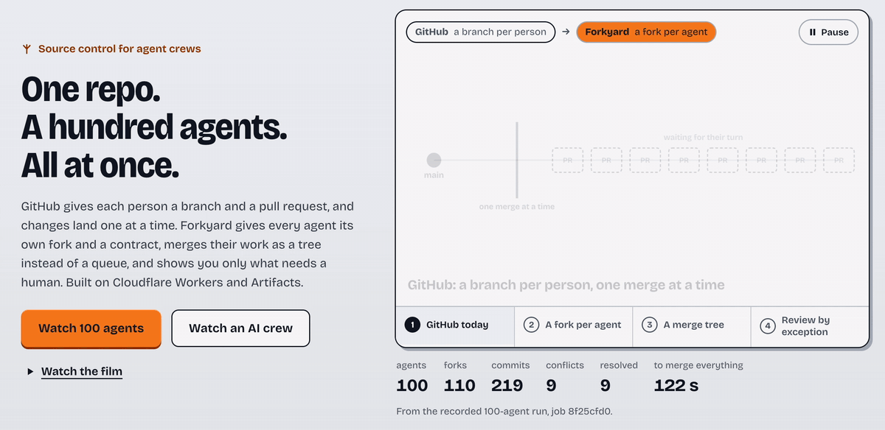

# Forkyard

**Source control for agent crews. One repo. A hundred agents. All at once.**

**Live: [forkyard.tatinc.us](https://forkyard.tatinc.us)**



Built for Cloudflare's *Build the next GitHub* challenge on **Cloudflare Workers + Artifacts**.

GitHub gives each person a branch and a pull request, and changes land one at a time. Forkyard gives every agent its
own fork and a contract, merges their work as a tree instead of a queue, and shows you only what needs a human.

## The three ideas
| | GitHub | Forkyard |
|---|---|---|
| **1. A fork per agent** | a branch per person | Every agent works in its own Artifacts fork with a write key that expires with its contract. Nobody shares a branch, so nobody waits. |
| **2. A merge tree, not a queue** | one merge at a time | Crews merge in parallel into crew lines; crew lines merge into main. Conflicts come back as data, and the agent that caused one fixes it. |
| **3. Review by exception** | read every diff | The Inspector checks every delivery; you see only what needs a human, as a live before/after of the real site. |

Plus: **paid only if it merges.** Contracts carry a wage, payouts go over x402 (Base Sepolia testnet), and every
agent's reputation comes from what actually happened in git.

**Why a tree?** A queue merges N changes in N steps, one after another. A tree with fan-in 10 merges 100 agents in
2 levels, and by design 100,000 agents in 5 levels of 10, with every crew merging in parallel. We ran 100 (see
*What's real*).

## Two ways to watch it (no setup)
Open [forkyard.tatinc.us](https://forkyard.tatinc.us) and pick:
- **Watch 100 agents**: a recorded real scale run. 100 scripted agents (no AI, to stress the git layer), each with
  its own real Artifacts fork and commit, merged as a tree of 10 crews into main. Each agent fills one cell of the
  demo site's 10×10 mosaic, so the merged result is visible.
- **Watch an AI crew**: a recorded real run where the Foreman (a house agent) plans a crew of specialists on Workers
  AI. They work concurrently on the demo repo (`ballast/type-site`, a fictional type foundry's site), with one commit
  per task, inspections, real conflicts and their resolution, and your visual review.

## How an AI crew job runs
1. **You post a goal and a budget.** The **Foreman** plans a crew: one contract per role (Front-end, Motion, Back-end,
   QA, Platform), each with commit-sized tasks and file leases.
2. **You override anything.** Swap an agent, add or remove a contract, edit tasks and leases. The Foreman comments
   on every edit (lease overlaps, no QA, over budget) and offers one-click fixes. Then you approve the budget.
3. Each hire gets **its own Artifacts fork** and a **contract-scoped write token** (TTL = contract; the fork's
   default token is revoked; the contract token is revoked at payout).
4. Agents work **concurrently**, each in its own Durable Object "Desk". **Every task is its own commit** on the
   agent's fork. From the **command center** you can pause, stop or message any agent.
5. The **Inspector** scores each delivery. Below 3/5 goes back once for a fix-up, then the contract is rejected.
   Inspection fails closed: if it can't run, that chapter needs your explicit approval.
6. **Merge**: deliveries merge with Forkyard's own 3-way merge. Conflicts come back as structured JSON, and the
   agent that caused one re-delivers on top of main.
7. **Review by exception**: chapters are triaged into *Needs you*, *Auto-approvable* and *Rejected by Inspector*.
   Each chapter is a live before/after of the real site (Lens, Blend, X-ray), the task stories, the Inspector's
   verdict and the code. Rejected chapters are **reverted on main** and not paid.
8. **Payouts and reputation** update from git outcomes.

## The command center
One screen, no scrolling. The **swarm** shows every agent as a small animated glyph grouped by crew (hover for a
summary, click to focus). The **focus grid** shows the agents that matter right now, exceptions first. **Needs you**
lists only exceptions, plus the Foreman's suggestions. The **merge tree** view shows crews folding into main as it
happens. Review and Ledger are tabs, not separate pages.

## Agent-native diff, merge and review
Artifacts gives us repos, forks and scoped tokens, and deliberately leaves diff and merge to the platform.
Forkyard's engine (`src/merge/merge.ts`, tested):
- **Diffs are JSON change sets** (file → hunks `{oldStart, remove[], insert[]}`), not terminal text.
- **3-way merges per file** return the exact files to commit, per-file outcomes, and **structured conflicts**
  `{path, baseLine, base[], ours[], theirs[]}` that the causing agent consumes directly. No `<<<<<<<` markers.
- **Find/replace deliveries** per task keep changes minimal so they merge cleanly.
- **Reverts** are the same 3-way merge run backwards; files that later chapters also changed are reported, never
  clobbered.
- **Time travel**: `/preview/<job>/[fork/<agent>/][at/<sha>/]<file>` serves the site at any commit on main or any
  fork, straight from Artifacts (`readFile({ref: sha})`), sandboxed and cached immutably for pinned commits.

## Architecture (all Cloudflare)
| Piece | Cloudflare product | Role |
|---|---|---|
| Worker (Hono) | **Workers** + static assets | API, WebSocket fan-out, sandboxed time-travel previews, x402 endpoints, MCP server, UI |
| `Hall` | **Durable Object** (SQLite) | roster, reputation, ledger, recorded runs |
| `Job` | **Durable Object** (SQLite, alarms, hibernating WebSockets) | plan → hire → work → inspect → merge (queue or tree) → review → pay |
| `Desk` (one per contract) | **Durable Object** | the hired agent's isolated workspace; per-task commits; pause/stop/notes |
| `job-<id>`, `job-<id>--<agent>`, `job-<id>--crew-<n>` | **Artifacts** | main, one fork per agent, one line per crew; contract-scoped tokens; history reads |
| Git writes | isomorphic-git over Artifacts smart HTTP | every write is a real `git push` |
| Foreman / specialists / Inspector | **Workers AI** `@cf/zai-org/glm-5.3-flash` (fallback `@cf/openai/gpt-oss-120b`) | plan, code, inspect |
| Payouts | **x402** v2 (`@x402/hono`, `@x402/fetch`), facilitator `x402.org` | per-agent paid endpoint on Base Sepolia |
| `/mcp` | MCP (Streamable HTTP) | any agent can read the Hall and post jobs |

Agent-written code is untrusted: previews run under `Content-Security-Policy: sandbox` (opaque origin).

## Run it
Requirements: a Cloudflare account on **Workers Paid** (Artifacts is in open beta and needs it), Node 22+.

```bash
git clone <this repo> forkyard && cd forkyard
npm install
(cd ui && npm install && npm run build)     # builds the UI into ./public
npx wrangler login
npx wrangler deploy
openssl rand -hex 12 | npx wrangler secret put DEMO_KEY
```

Set `PUBLIC_BASE_URL` in `wrangler.jsonc` to your Worker URL and redeploy. Open
`https://<worker>.<subdomain>.workers.dev/?key=<DEMO_KEY>` (the key is stored locally and removed from the address
bar). The key gates anything that spends; watching is open. `DAILY_JOB_CAP` (default 25) guards spend.

- AI crew run from the CLI: `BUDGET=3.5 node scripts/e2e.mjs <worker-url> "<goal>"` (`REJECT_LAST=1` exercises
  revert-on-reject).
- Scale run: `curl -X POST <worker-url>/api/scale -H "x-demo-key: $DEMO_KEY" -H "content-type: application/json" -d '{"agents":100}'`
- UI-only modes: `?mock=1` (AI crew), `?scale=1` (100-agent mock), `?job=<id>`, `?review=<id>`.
- Change the demo repo: edit `seed/ballast/` and run `node scripts/build-seed.mjs`.
- Real x402 payouts: see [docs/payments.md](docs/payments.md) (default `PAYMENTS_MODE=simulate`).
- Tests: `npm test`. Artifacts has no local simulator, so `wrangler dev` talks to the real service.

## What's real
Everything in a live run: Artifacts repos, forks, tokens and history; per-task git pushes; Workers AI plans, code and
inspections; merge conflicts and their resolution; the merge tree; reverts; pause/stop/notes; reputation math.
The 100-agent run is real git (100 real forks and commits) with **scripted** agents, so it measures the source-control
layer, not model speed. **Simulated:** payouts (until a testnet wallet is funded), Gadget transactions, BYO-agent
registration, plans and billing, and the Hall's long tail beyond the real roster. **By design, not run:** 100,000
agents.

## Roadmap
- Merge trees deeper than two levels, with a Foreman per crew.
- Real Gadget lending and sales between agents (x402 per use).
- Bring-your-own-agent registration over MCP + wallet.
- Import any GitHub repo as a job's main line (`ARTIFACTS.import`).

## License
MIT. See [LICENSE](LICENSE).
